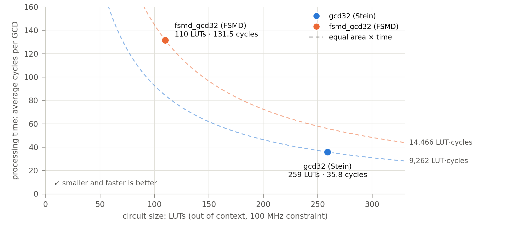
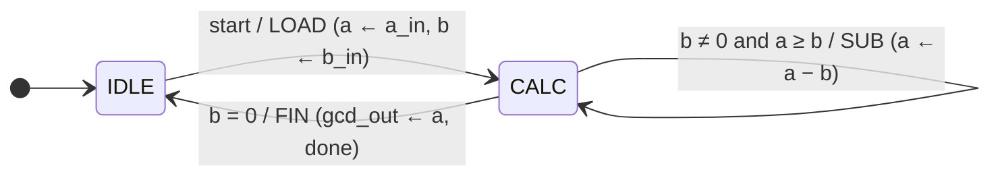
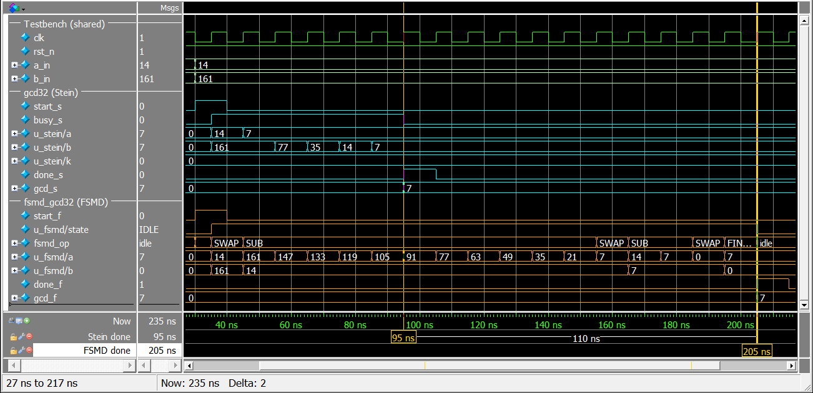
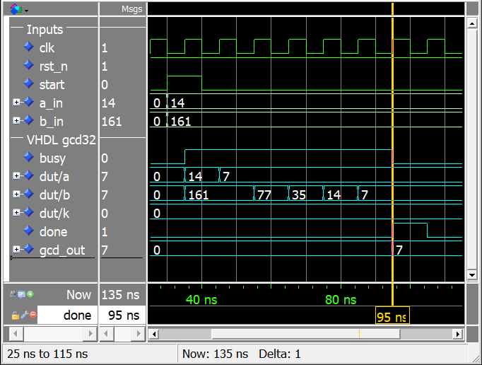
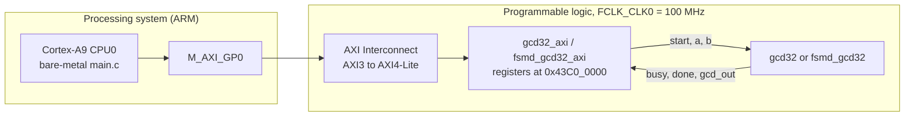
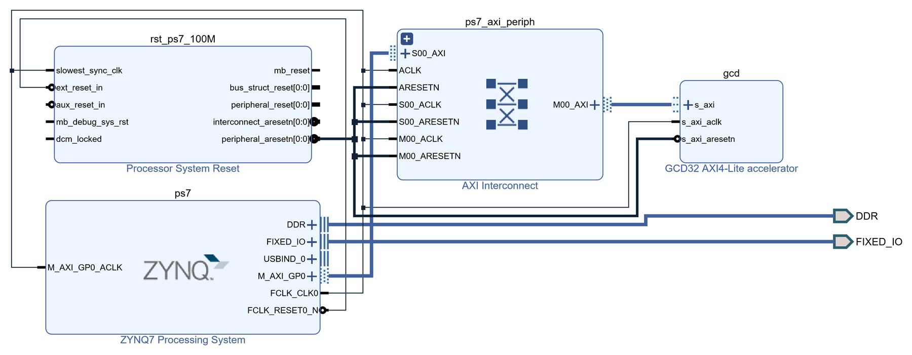

<div align="center">

# GCD32: Processing Time vs. Circuit Size

**Two 32-bit greatest-common-divisor (GCD) hardware cores, verified in simulation and run on a Zynq-7000 FPGA**


</div>

---

## Overview

The task was to design an FPGA circuit that computes the GCD of two 32-bit integers, show
the simulation of **gcd(14, 161)**, and optimize **both processing time and circuit size**.
Those two goals pull against each other, so instead of one compromise this project builds
**two architectures, one at each end of the trade-off**, and compares them under identical
conditions:

| Core | Algorithm | Optimized for |
|---|---|---|
| [`gcd32`](rtl/gcd32.v) | **Stein's binary GCD**: shift and subtract, one step per clock | ⚡ processing time |
| [`fsmd_gcd32`](rtl/fsmd_gcd32.v) | **Euclid by repeated subtraction**, as an explicit FSM + datapath (FSMD) | 📦 circuit size |

Both cores have the same ports and handshake, so they are drop-in replacements for each other.
Each one has:

- a self-checking testbench (plus one that runs both cores side by side);
- an **AXI4-Lite** wrapper;
- a Vivado block design for the **Zybo Z7-20**;
- a bare-metal test program that ran on the board.

The Stein core also has a **VHDL** version ([`rtl/gcd32.vhd`](rtl/gcd32.vhd)), checked
cycle by cycle against the Verilog one.

> **Task:** *"Write the VHDL code of a circuit (FPGA) that computes the greatest common divisor
> (GCD) between two 32-bit integers. If possible, please report the simulation results when your
> circuit computes the GCD of 14 and 161. Think at optimizing the processing time and the circuit
> size as much as you can."*

---

## Results at a glance

| | `gcd32` (Stein) | `fsmd_gcd32` (FSMD) | Better |
|---|---:|---:|---|
| **gcd(14, 161)** | **7** cycles = 70 ns | 18 cycles = 180 ns | Stein, 2.57× |
| Worst case, 32-bit operands | **64** cycles | 2³² + 4 ≈ 4.29 × 10⁹ cycles (≈ 43 s) | Stein |
| Average, 10,000 board test vectors | **35.8** cycles | 131.5 cycles | Stein, 3.68× |
| Time per call on the board (incl. AXI) | **1,180 ns** | 2,173 ns | Stein, 1.84× |
| LUTs (out of context, post-route) | 259 | **110** | FSMD, −58 % |
| Slices | 73 | **38** | FSMD, −48 % |
| Flip-flops | 103 | **98** | FSMD, −5 |
| BRAM / DSP | 0 / 0 | 0 / 0 | – |
| F<sub>max</sub> (xc7z020-1) | 215 MHz | 215 MHz | tie |
| Area × time (LUTs × average cycles) | **9,262** | 14,466 | Stein, 1.56× |

<p align="center">
  
</p>

**Verdict:**

- **Stein (`gcd32`) is the better design overall.** It is faster and its latency is bounded
  (≤ 64 cycles). It also does more work per LUT, with a 1.56× lower area–time product.
- **The FSMD (`fsmd_gcd32`) is the choice only when area is the hard limit.** It is 58 %
  smaller, but its latency depends on the data and can reach about 4.3 billion cycles.

Sources:

- Board results: [`results/board/`](results/board).
- Synthesis results: [`results/synthesis/ooc_summary.txt`](results/synthesis/ooc_summary.txt).
- Simulation results: [`results/simulation/`](results/simulation).
- Full write-up: [`docs/GCD32_Time_vs_Area_Report.pdf`](docs/GCD32_Time_vs_Area_Report.pdf).

---

## Repository structure

```
.
├── rtl/                        synthesizable cores
│   ├── gcd32.v                 Stein's binary GCD (Verilog), time-optimized
│   ├── gcd32.vhd               the same core in VHDL
│   └── fsmd_gcd32.v            subtractive Euclid as an FSMD (Verilog), area-optimized
├── axi/                        AXI4-Lite slave wrappers (register interface for the ARM)
│   ├── gcd32_axi.v
│   └── fsmd_gcd32_axi.v        same register map + 64-bit cycle counter
├── tb/                         self-checking testbenches
│   ├── tb_gcd32.v              Stein core (Verilog)
│   ├── tb_gcd32.vhd            Stein core (VHDL)
│   ├── tb_gcd32_vhdl.vhd       VHDL core vs Verilog core, compared every clock cycle
│   ├── tb_fsmd_gcd32.v         FSMD core
│   ├── tb_compare.v            both cores on the same inputs
│   ├── tb_gcd32_axi.v          AXI4-Lite level test of the Stein wrapper
│   └── tb_fsmd_gcd32_axi.v     AXI4-Lite level test of the FSMD wrapper
├── sim/                        QuestaSim scripts: one per testbench + regression.do
├── synth/
│   └── synth_ooc.tcl           Vivado out-of-context synthesis: area and Fmax of both cores
├── zynq/                       Zybo Z7-20 flow (Vivado / Vitis 2021.1)
│   ├── board_files/            Digilent Zybo Z7-20 board files (MIT license)
│   ├── gcd32/                  build_hw.tcl, run_sw.tcl, run_all.sh, main.c
│   └── fsmd_gcd32/             build_hw.tcl, run_sw.tcl, run_all.sh, main.c
├── results/                    saved evidence
│   ├── simulation/             transcripts of the regression (one log per testbench)
│   ├── synthesis/              out-of-context summary, full-system utilization and timing
│   └── board/                  UART output of the board tests
└── docs/
    ├── GCD32_Time_vs_Area_Report.pdf   4-page report: both architectures compared
    ├── GCD32_VHDL_Report.pdf           2-page report: the VHDL version of the Stein core
    └── images/
```

---

## Common interface

Both cores have exactly the same ports and handshake:

```verilog
module gcd32 /* or fsmd_gcd32 */ (
    input  wire        clk,
    input  wire        rst_n,      // active-low synchronous reset
    input  wire        start,      // 1-cycle pulse with a_in / b_in valid (ignored while busy)
    input  wire [31:0] a_in,
    input  wire [31:0] b_in,
    output      busy,              // operation in progress
    output reg         done,       // 1-cycle pulse: gcd_out is valid
    output reg  [31:0] gcd_out     // holds its value until the next operation
);
```

- **Zero operands:** gcd(x, 0) = x and gcd(0, 0) = 0.
- **Latency:** counted from the start cycle to the done cycle. The testbenches and the `CYCLES`
  register of the AXI wrappers all use this same definition.

---

## Architecture 1: `gcd32`, Stein's binary GCD (processing time)

Division is expensive in hardware, but halving a binary number is free: it is just wiring.
Stein's algorithm uses only shifts, one subtraction and a comparison. It performs **one step
per clock cycle**:

| Condition | Register update |
|---|---|
| a = b | done, `gcd_out ← a << k` |
| a and b even | `a ← a >> 1`, `b ← b >> 1`, `k ← k + 1` |
| a even, b odd | `a ← a >> 1` |
| a odd, b even | `b ← b >> 1` |
| both odd, a > b | `a ← (a − b) >> 1` |
| both odd, a < b | `b ← (b − a) >> 1` |

- `k` counts the common factors of two, and the final shift `a << k` puts them back.
- **`a − b` and `b − a` are computed in parallel.** The borrow of `a − b` selects the result,
  so there is no compare-then-subtract chain on the critical path.
- **Every step removes at least one bit** from `a` or `b`, so no 32-bit input needs more than
  **64 cycles**. That bound is reached by gcd(2³² − 1, 2³² − 2).

**Trace of gcd(14, 161)**, the required test (`start` is sampled at 35 ns, 100 MHz clock):

| Cycle | a | b | k | Step |
|:---:|---:|---:|:---:|---|
| 1 | | | | load a = 14, b = 161 |
| 2 | 14 | 161 | 0 | a even → a ← a/2 |
| 3 | 7 | 161 | 0 | both odd → b ← (b − a)/2 |
| 4 | 7 | 77 | 0 | both odd → b ← (b − a)/2 |
| 5 | 7 | 35 | 0 | both odd → b ← (b − a)/2 |
| 6 | 7 | 14 | 0 | b even → b ← b/2 |
| 7 | 7 | 7 | 0 | a = b → **gcd_out = 7**, done at 95 ns |

---

## Architecture 2: `fsmd_gcd32`, subtractive Euclid as an FSMD (circuit size)

```
while (b != 0)
    if (a < b) swap(a, b);   // keep the larger value in a
    else       a = a - b;
gcd = a
```

- **Datapath:** registers `a`, `b`, `gcd_out` and **a single 32-bit subtractor**. The
  subtractor's borrow doubles as the `a < b` comparator, and a zero detector on `b` ends the loop.
- **Controller:** two states, one micro-operation per clock.



- **Latency** = 2 + Σ (qᵢ + 1) cycles, where qᵢ are the Euclid quotients.
  - gcd(14, 161) takes **18 cycles**: LOAD, SWAP, 11 × SUB, SWAP, 2 × SUB, SWAP, FIN.
  - The worst case, gcd(2³² − 2, 2³² − 1), takes 2³² + 4 cycles: about 43 s at 100 MHz.
- **Zero operands need no extra logic:** gcd(x, 0) and gcd(0, 0) fall out of the loop.

---

## Verification

Seven self-checking testbenches run in **QuestaSim 2021.1**:

- all seven check every result against a software Euclid reference;
- five of them also check every latency against the cycle model of the core. The two basic Stein
  testbenches only report the latency.

| Script (`sim/`) | Testbench | What it checks | Operations | Errors |
|---|---|---|---:|:---:|
| `gcd32.do` | `tb_gcd32.v` | gcd(14, 161) trace, corner cases, 10,000 random vectors | 10,011 | 0 |
| `gcd32_vhdl.do` | `tb_gcd32.vhd` | the same tests for the VHDL core | 10,011 | 0 |
| `vhdl_vs_verilog.do` | `tb_gcd32_vhdl.vhd` | VHDL and Verilog cores in **lockstep**, outputs compared every clock cycle; 18 board vectors, all 8-bit pairs, 10,000 board vectors | 75,555 | 0 |
| `fsmd_gcd32.do` | `tb_fsmd_gcd32.v` | trace, corner cases, latency growth, all pairs 0..31, 10,000 random vectors | 11,039 | 0 |
| `compare.do` | `tb_compare.v` | **both cores on the same inputs**: gcd(14, 161), 18 board vectors, latency growth, all 65,536 8-bit pairs, 2 × 10,000 random vectors | 85,565 | 0 |
| `gcd32_axi.do` | `tb_gcd32_axi.v` | AXI4-Lite master BFM with random handshake delays: register map, `WSTRB`, START while busy, protocol rules, 3,000 random driver calls | 3,025 checks | 0 |
| `fsmd_gcd32_axi.do` | `tb_fsmd_gcd32_axi.v` | the same for the FSMD wrapper, plus the 64-bit `CYCLES` counter | 3,028 checks | 0 |

In `tb_compare`, an FSMD run longer than 2²⁴ cycles is not simulated; its latency comes from the
cycle model instead. This applies to 8 of the 85,565 vectors.

- Three of those vectors were also run on the board, and the board's cycle counts match the
  model exactly.
- To simulate them anyway, run `vsim -c -do "set fsmd_limit 400000000; do compare.do"`. This
  takes hours.

### Running the simulations

Run the scripts from the `sim/` folder. Each script compiles what it needs into libraries in
that folder.

```bash
cd sim
vsim -c -do regression.do     # all 7 testbenches in batch, summary at the end (~2 min)
vsim -c -do compare.do        # one testbench in batch, transcript in compare.log
vsim    -do compare.do        # GUI: waveform of gcd(14, 161) on both cores
```

Output of `regression.do` ([`results/simulation/regression.log`](results/simulation/regression.log)):

```
==== Regression summary (2026-10-14 12:37) ====
gcd32            Stein core, Verilog testbench          PASS    7 s   tests = 10011   errors = 0
gcd32_vhdl       Stein core in VHDL, VHDL testbench     PASS   11 s   tests = 10011   errors = 0
vhdl_vs_verilog  VHDL core vs Verilog core, lockstep    PASS   22 s   tests = 75555   result/latency errors = 0   cycles where VHDL and Verilog outputs differ = 0
fsmd_gcd32       FSMD core                              PASS   14 s   tests = 11039   errors = 0 (result and latency checked)
compare          Both cores, same inputs                PASS   21 s   tests = 85565   errors = 0 (both cores: result and latency checked; fsmd simulated in 85557, model in 8)
gcd32_axi        Stein core behind AXI4-Lite            PASS   11 s   checks = 3025   errors = 0
fsmd_gcd32_axi   FSMD core behind AXI4-Lite             PASS   11 s   checks = 3028   errors = 0
ALL 7 TESTBENCHES PASSED
```

`regression.do` exits with the number of failed testbenches, so it can also run in CI.

### gcd(14, 161): the required simulation

Both cores start on the same clock edge (`sim/compare.do` in GUI mode).

- **Stein** finishes at **95 ns**: 7 cycles.
- **FSMD** finishes at **205 ns**: 18 cycles.
- Both return **gcd_out = 7**.

<p align="center">
  
</p>

The VHDL version of the Stein core gives the same result in the same 7 cycles
(`tb_gcd32_vhdl.vhd`, run by `sim/vhdl_vs_verilog.do`):

<p align="center">
  
</p>

---

## FPGA implementation: Zybo Z7-20 (Zynq-7020)

Each core sits behind an AXI4-Lite slave in the programmable logic (PL). The ARM Cortex-A9
drives it as a memory-mapped peripheral.



**Vivado block design**, generated by `zynq/gcd32/build_hw.tcl`. The FSMD system is the same,
except for the custom IP block.

<p align="center">
  
</p>

### AXI4-Lite register map

Base address `0x43C0_0000`, 4 KB window.

| Offset | Register | Access | Description |
|---|---|:---:|---|
| `0x00` | `CTRL` | W | bit 0 `START`: write 1 to start (ignored while busy); reads as 0 |
| `0x04` | `STATUS` | R | bit 0 `BUSY`; bit 1 `DONE` (sticky, cleared by START) |
| `0x08` | `A` | R/W | operand a |
| `0x0C` | `B` | R/W | operand b |
| `0x10` | `RESULT` | R | gcd(a, b) of the last operation |
| `0x14` | `CYCLES` | R | latency of the last operation in clock cycles (bits 31:0) |
| `0x18` | `ID` | R | `0x47434431` "GCD1" (Stein) or `0x47434432` "GCD2" (FSMD) |
| `0x1C` | `CYCLES_HI` | R | FSMD only: bits 63:32 of the latency (it can exceed 2³² cycles) |

Driver sequence ([`zynq/gcd32/main.c`](zynq/gcd32/main.c)):

```c
gcd_write(GCD_REG_A, a);
gcd_write(GCD_REG_B, b);
gcd_write(GCD_REG_CTRL, GCD_CTRL_START);
while ((gcd_read(GCD_REG_STATUS) & GCD_STATUS_DONE) == 0U) { /* poll, with a limit */ }
result = gcd_read(GCD_REG_RESULT);
cycles = gcd_read(GCD_REG_CYCLES);
```

### Build and run on the board

Requirements:

- Linux with bash, and Vivado + Vitis 2021.1. The scripts look for them in `/tools/Xilinx`; set
  `XILINX_ROOT` if they are installed elsewhere.
- To run on the board: a Zybo Z7-20 with boot jumper JP5 set to **JTAG**, connected over USB.
  The program prints to the board UART at 115200 8N1.

```bash
cd zynq/gcd32            # or zynq/fsmd_gcd32
./run_all.sh build       # sim -> hw -> sw: AXI testbench (xsim), bitstream + XSA, ELF   (~6 min)
./run_all.sh run         # program the PL over JTAG, run main.c, capture the UART
./run_all.sh             # all stages
```

| Stage | Script | What it does |
|---|---|---|
| `sim` | `run_all.sh` | AXI-level testbench in the Vivado simulator |
| `hw` | `build_hw.tcl` | packages core + wrapper as an IP, builds the block design, synthesis, implementation, bitstream, timing check, exports the `.xsa` |
| `sw` | `run_sw.tcl build` | Vitis platform, standalone BSP, `main.c` application |
| `run` | `run_sw.tcl run` | JTAG: programs the PL, `ps7_init`, register smoke test, downloads and runs the ELF |

Every run is saved under `zynq/<design>/results/` (logs, reports and a `summary.txt`).

### Board results

The board test runs on both designs:

- the ID register check;
- 18 directed vectors, each checked against its known result;
- 10,000 random vectors against a software reference;
- time per call, in hardware and in software.

Both designs pass with **0 failures**. For both designs, the cycle counts measured on the board
match the simulation for all 18 directed vectors. The FSMD program also checks every cycle count
against its cycle model on the board itself.

| On the board | `gcd32` (Stein) | `fsmd_gcd32` (FSMD) |
|---|---:|---:|
| gcd(14, 161) | 7 cycles | 18 cycles |
| gcd(4294967295, 1) | 33 cycles | 4,294,967,298 cycles (42.9 s) |
| gcd(4294967291, 4294967279) | 36 cycles | 357,913,958 cycles (3.6 s) |
| Time per call through AXI4-Lite | 1,180 ns | 2,173 ns |
| Same vectors in software on the Cortex-A9 | 887 ns | 903 ns |
| Whole PL design: LUTs / flip-flops | 743 / 736 | 596 / 763 |
| Timing at 100 MHz: WNS / WHS | 3.424 / 0.057 ns | 3.133 / 0.034 ns |

About **0.84 µs of every call is AXI4-Lite register traffic**: three register writes, the
`STATUS` polling and the `RESULT` read. That is why a single call through AXI-Lite does not beat
the ARM in software. The core itself needs only 0.36 µs on average (35.8 cycles at 100 MHz).

Full UART output: [`results/board/`](results/board).

### Out-of-context synthesis

`synth/synth_ooc.tcl` synthesizes and places-and-routes each core alone, on the xc7z020clg400-1
with default settings. It does two runs per core:

- a 10 ns clock, for the circuit size;
- a 3 ns clock, for F<sub>max</sub> = 1 / (3 ns − WNS).

```bash
mkdir -p synth/run && cd synth/run
vivado -mode batch -nojournal -source ../synth_ooc.tcl
```

Saved run: [`results/synthesis/ooc_summary.txt`](results/synthesis/ooc_summary.txt).

| Core | LUTs | FFs | CARRY4 | Slices | BRAM | DSP | F<sub>max</sub> |
|---|---:|---:|---:|---:|---:|---:|---:|
| `gcd32` (Stein) | 259 | 103 | 20 | 73 | 0 | 0 | 215 MHz |
| `fsmd_gcd32` (FSMD) | 110 | 98 | 9 | 38 | 0 | 0 | 215 MHz |

The FSMD is smaller because it has:

- **one subtractor instead of two**;
- **a swap instead of shift multiplexers**;
- **no `k` counter**, and no barrel shifter for `a << k`.

The 5 flip-flops it saves are exactly the width of `k`.

---

## Reports

- 📄 [**Processing Time versus Circuit Size in a 32-Bit FPGA GCD Unit**](docs/GCD32_Time_vs_Area_Report.pdf):
  4-page IEEE-style report covering both architectures, verification, the FPGA deployment and
  the comparison.
- 📄 [**A VHDL Version of the 32-Bit Stein GCD Core**](docs/GCD32_VHDL_Report.pdf): 2-page report
  on the VHDL core and its lockstep verification against the Verilog core.

---

## Tools

| Purpose | Tool |
|---|---|
| HDL | Verilog-2001, VHDL-2008 |
| Simulation | QuestaSim 2021.1 (Mentor); Vivado Simulator (AXI testbenches in the board flow) |
| Synthesis and implementation | Xilinx Vivado 2021.1 |
| Software | Xilinx Vitis 2021.1, bare-metal (standalone BSP) on the Cortex-A9 |
| Board | Digilent Zybo Z7-20 (xc7z020clg400-1) |

---

<div align="center">

## 👨‍💻 Author

**Ahmed Saad Sweffi**

[](https://www.linkedin.com/in/ahmed-saad-sweffi-09b2751a9)

Digital Design & Verification Engineer — RTL • FPGA • VLSI

</div>
